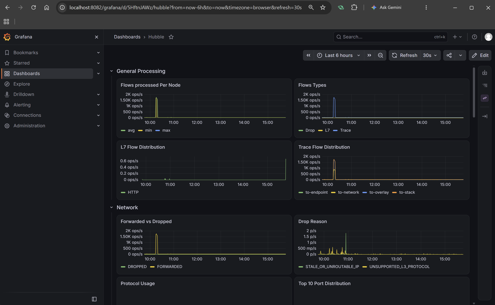
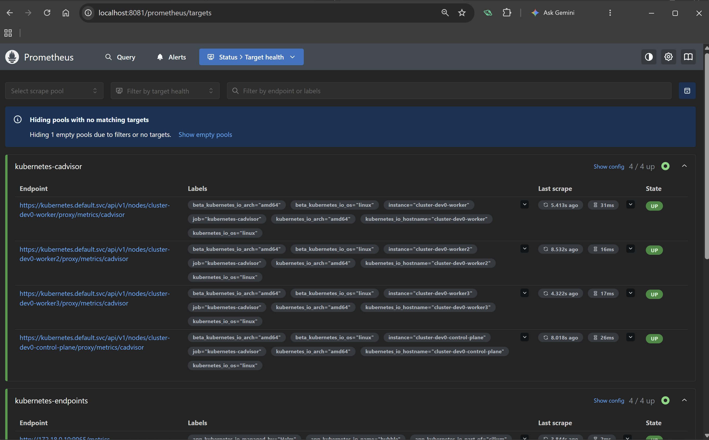
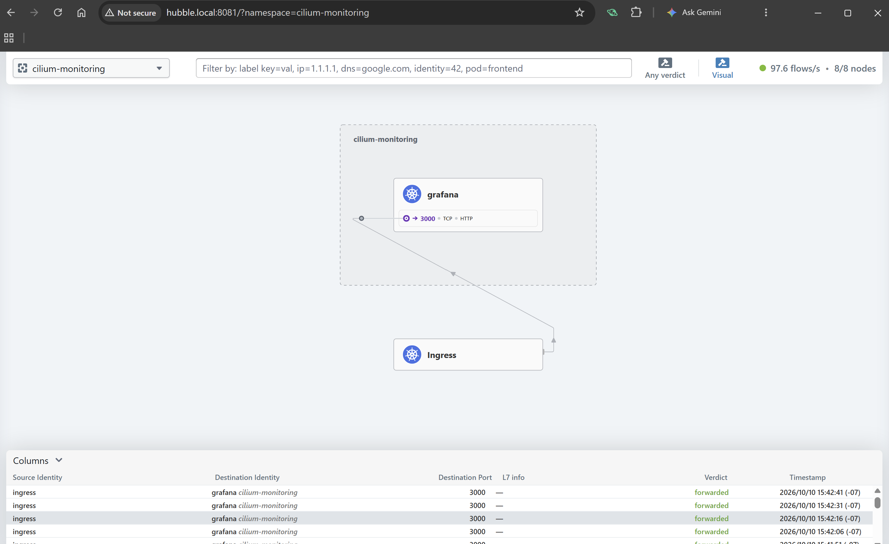
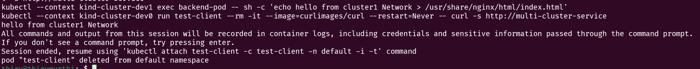
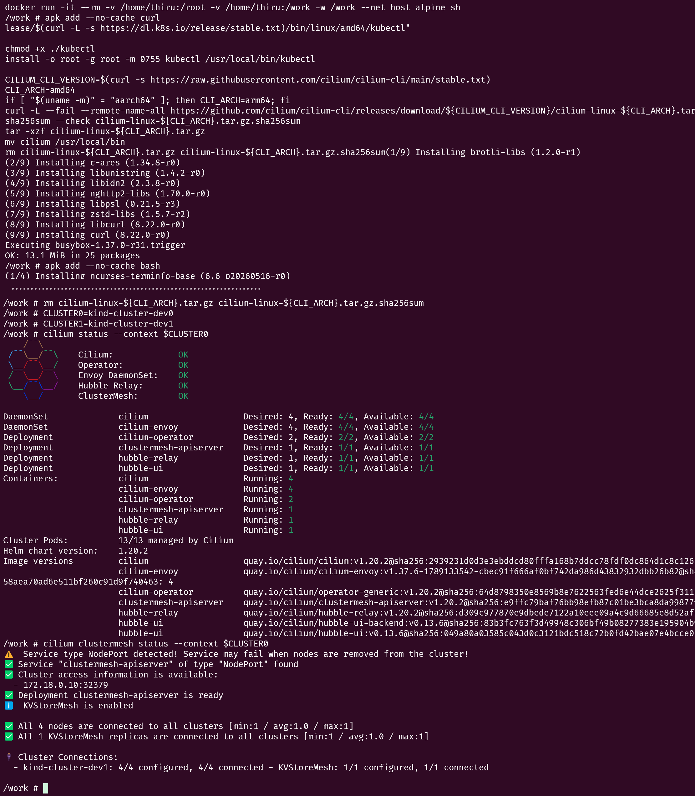
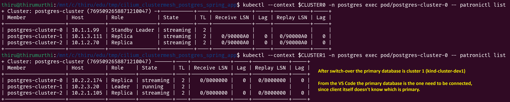
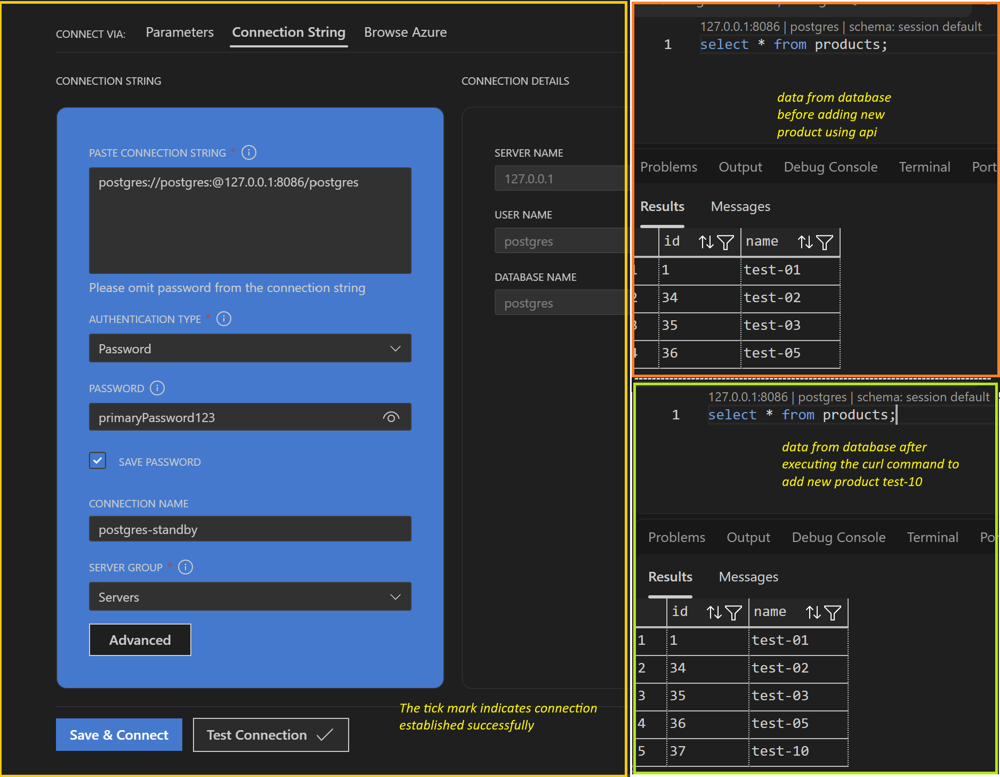
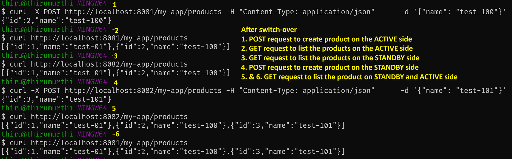
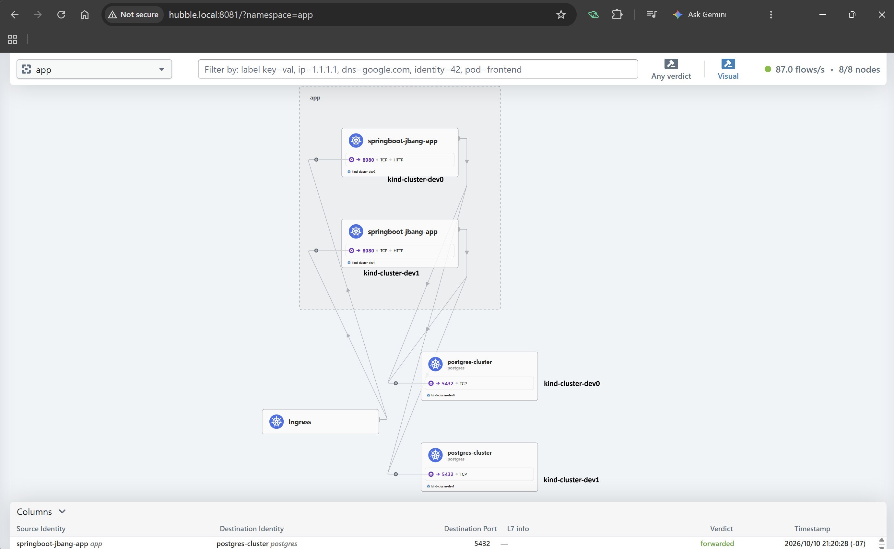
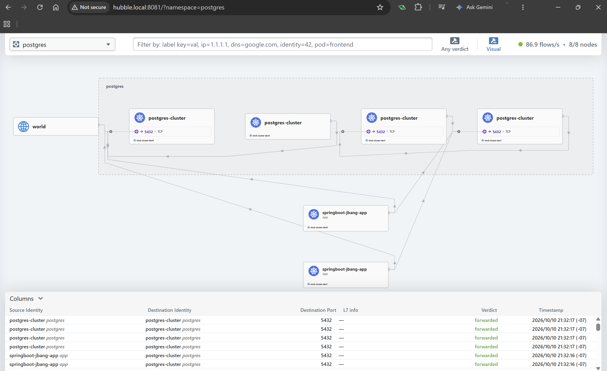

## Multi-cluster Cilium Clustermesh Demonstrating Active-Standby Database and Active-Active Application

This article details on creating two Kubernetes cluster using KinD and configuring both with Cilium clustermesh, the primary goal is to demonstrate how to configure Postgres DB in synchronized streaming replication between cluster. Thus database would be in Active-Standby mode. Also, a Spring Boot application deployed to connect to the primary database instance, thus the application would be in Active-Active mode.

The spring application identifies the primary database instance using the Cilium service discovery between the clusters. To start with the cluster 0 will be Active and the cluster 1 will be in Standby mode. When database is switched over the current Standby to Active and the current Standby to Active, we could observe the Spring Boot application automatically connects to the primary instance at all time. This is achived with the Hikari pool connection configuration `targetServerType=primary` in the database connection string itself.

Recently had to develop similar architecture at work with totally different approach. But in here documented some of the setup using KinD cluster locally so it can be used for learing and development purposes.


### Prerequisites

  - Docker Desktop
  - KinD CLI
  - Kubectl CLI
  - Helm CLI
  - Cilium CLI (To check the status of status)
  - JBang CLI

### Summary

Summary of steps to deploy the multi-cluster environment using KinD with cilium cluster mesh and configure Postgres DB with Zalando operator in Active-Standby. Create a simple application in Active-Active mode and connects to the primary instance of database. The manfiest configurations are available in [Github repository](https://github.com/thirumurthis/projects/tree/main/cilium_clustermesh_postgres_spring_app).

This article does not explain all the concepts, to follow the along these steps basic understanding of Kubernetes is required.

  1. Cilium deployment
     a. Create clusters (cluster 0 and cluster 1) with kind configuration using KinD CLI.
     b. First deploy the Cilium to cluster 0 using the configuration from the Github repo.
     c. Copy the cilium-ca secret from cluster 0 to cluster 1.
     d. Deploy the Cilium to cluster 1 using the configuration from the Github repo.
     e. Cilim metrics are enabled to monitor using Grafana, Prometheus and Hubble UI.
     f. Kuberenetes Gateway API is installed to configure Gateways to create HTTPRoute and TCPRoute to access the monitoring UI's.
  2. Database installation
     a. Create the namespace to deploy the Postgres using Zalando operator.
     b. Deploy the Zalando operator on cluster 0.
     c. Deploy the Zalando operator on cluster 1.
     d. Create secret with password on both clusters, this will be used by Zalando operator when creating Postgres database instance. The name of the secret should match the Zalando operator name format else the operator will creates its own random password.
     e. Create Postgres DB instance in cluster 0. This is the primary database.
     f. Create Postgres DB instance in cluster 1. This is the standby database, configuration includes standby_host and port.
     g. Install TCPRoute route on both clusters to access the Postgres database from host machine.
  3. Spring Boot application
     a. Create secret with Postgres database credentials for the Spring Boot application.
     b. Deploy the Spring Boot application with simple API endpoint to access the database.
     c. Create the HTTPRoute for application to access the API from the host machine.
  4. Verify access at each step and finally perform switch over of Postgres database.


Steps to switch over postgres database 
  - Initially the Standby cluster needs to be promoted to Active, this is done by patching the Postgres cluster configuration to remove the standby configuration. In this case, the standalone_host and port configuration will be removed. Wait for a moment and then move to next step.
  - Next the Active cluster needs to be demoted to Standby. In this case the standby_host and port configuration needs to be updated using kubectl patch.

The application access should not be interrupted before and after switch over.

Note, this configuration is not production grade refer the Cilium and Zalando documentation for more details.

### Source code

The manifests configuration used to setup the clusters can be found in the [Github repository](https://github.com/thirumurthis/projects/tree/main/cilium_clustermesh_postgres_spring_app)

The configuration files in the Github repo is structured like below,
  - File name starting with cluster_0 includes configuration specific for cluster 0
  - File name starting with cluster_1 includes configuration specific for cluster 1
  - File name starting with culsters_ is the common configuration for both the clusters
  - readme.md file documents the steps with the commands to setup the environment
  - spring-app folder contains the Spring Boot application code

The Github repo is configured with predefined values like cluster name, ports. If wanted to update consider below points
  - cluster names used are cluster-dev0 and cluster-dev1
  - extraPortMappings uses host port 8081, 8085, 8082, 8086, etc in KinD configuration for HTTP, HTTPS and TCP traffic. The TCP is used for Postgres database access from the host machine.
  - If considering to change cluster names or ports, the cilium manfiest also needs to be updated.

### Create Kind clusters

The KinD configuration for cluster 0 is shown below, it includes extraPortMappings configured to access apps from host machine.
The default CNI is disabled in the KinD configuration, the service and pod subnet defined since the Cilium requires different IP address. The default kubeProxy is disabled. 

To use the Cilium proxy, the Cilium configuration needs to be updated with below details. 

```yaml
kubeProxyReplacement: true
k8sServiceHost: cluster-dev0-control-plane  # the docker container name
k8sServicePort: 6443
```

The kind configuration for cluster 0

```yaml
# file name: cluster_0_kind_config.yaml
kind: Cluster
apiVersion: kind.x-k8s.io/v1alpha4
networking:
   disableDefaultCNI: true
   podSubnet: "10.1.0.0/16"
   serviceSubnet: "10.11.0.0/16"
   kubeProxyMode: "none"
nodes:
  - role: control-plane
    extraPortMappings:
      - containerPort: 31081
        hostPort: 8081
        protocol: TCP
      - containerPort: 31443
        hostPort: 8443
        protocol: TCP
      - containerPort: 31235
        hostPort: 8085
        protocol: TCP
  - role: worker
  - role: worker
  - role: worker
```

To apply the kind cluster manifest use below command

```sh
kind create cluster --name cluster-dev0 --config cluster_0_kind_config.yaml
```

The KinD configuration for cluster 1

```yaml
# cluster_1_kind_config.yaml
kind: Cluster
apiVersion: kind.x-k8s.io/v1alpha4
networking:
   disableDefaultCNI: true
   podSubnet: "10.2.0.0/16"
   serviceSubnet: "10.12.0.0/16"
   kubeProxyMode: "none"
nodes:
  - role: control-plane
    extraPortMappings:
      - containerPort: 31082
        hostPort: 8082
        protocol: TCP
      - containerPort: 31444
        hostPort: 8444
        protocol: TCP
      - containerPort: 31236
        hostPort: 8086
        protocol: TCP
  - role: worker
  - role: worker
  - role: worker
```

To create the cluster 1 apply the manifest using below command

```sh
kind create cluster --name cluster-dev1 --config cluster_1_kind_config.yaml
```

#### Configure the kubernetes context to variable 

The following command uses the variable for the context and makes the installation easier, when cluster is creatd by KinD the kube config is automatically updates the kube config.

```sh
CLUSTER0=kind-cluster-dev0
CLUSTER1=kind-cluster-dev1 
```

### Create Cilium clustermesh

The common Cilium configuration to be applied to both the cluster, which will be passed as override to the helm command when installing the Cilium clustermesh

```yaml
#file name: clusters_cilium_common_config.yaml
clustermesh:
  config:
    clusters:
      kind-cluster-dev0:
        enabled: true
        address: cluster-dev0-control-plane
        port: 32379 
      kind-cluster-dev1:
        enabled: true
        address: cluster-dev1-control-plane
        port: 32380

gatewayAPI:
   enabled: true
   hostNetwork:
    enabled: false # if hostnetwork true only HTTPRoute and HTTPSRoute works, for TCPRoute set to false

kubeProxyReplacement: true

l7Proxy: true

envoy:
  enabled: true
  securityContext:
    capabilities:
      keepCapNetBindService: true
      envoy:
      - NET_BIND_SERVICE
      - NET_ADMIN
      - SYS_ADMIN
      - BPF

# Mandated for Kind environments so Cilium attaches to the 
# nested container cgroup layout properly
cgroup:
  autoMount: 
    enabled: true
  hostRoot: /sys/fs/cgroup

ipam:
  mode: kubernetes

hubble:
  relay: 
    enabled: true
  metrics:
    enableOpenMetrics: true
    enabled:
     - dns:query;ignoreAAAA
     - drop
     - tcp
     - flow
     - icmp
     - http
     - https
  ui:
    enabled: true

operator:
  prometheus:
     enabled: true 
     port: 6942
```

#### Deploy the Cilium to cluster 0 

The Cilium configuration for cluster 0, which requires a name and id for the cluster. The Cilium creates an agent and api server, the api server uses the NodePort to communicate between cluster. For production environment LoadBalancer is recommended for security reasons. 

```yaml
#file name: cluster_0_cilium_config.yaml
cluster:
  name: kind-cluster-dev0
  id: 1

clustermesh:
  useAPIServer: true

  config:
    enabled: true

  apiserver:
    service:
      type: NodePort  # clusterMesh Api in this case exposed using NodePort 
      nodePort: 32379 # all cilium pods from other cluster will reach to this endpoint
      annotations: {}

    tls:
      auto:
        enabled: true
        method: cronJob
        server:
          extraDnsNames:
            - cluster-dev0-control-plane
            - cluster-dev1-control-plane

# since the kubeproxy is disabled the docker control plane hostname should be added
k8sServiceHost: cluster-dev0-control-plane
k8sServicePort: 6443
```

To deploy the Cilium in the cluster 0, we can use below helm command deploy to the kube-system namespace.

```sh
helm upgrade -i cilium oci://quay.io/cilium/charts/cilium --version 1.20.2 \
   --namespace kube-system \
    -f clusters_cilium_common_config.yaml \
    -f cluster_0_cilium_config.yaml \
    --kube-context $CLUSTER0
```

#### Copy the secret from the cluster 0 to cluster 1

This is requires for the clustermesh, so the cluster 0 and cluster 1 communicates with NodePort using common certificate. Note, there are different approach for this step refer the documentation for more details.

The cilium creates certificate in secret which will be copied over to the cluster 1 in this case

```bash
kubectl --context $CLUSTER0 get secret -n kube-system cilium-ca -o yaml | \
    kubectl --context $CLUSTER1 create -f -
```

#### Deploy the Cilium to cluster 1

The Cilium configuration for cluster 1 is shown below

```yaml
#file name: cluster_1_cilium_config.yaml
cluster:
  name: kind-cluster-dev1
  id: 2

clustermesh:
  useAPIServer: true

  config:
    enabled: true

  apiserver:
    service:
      type: NodePort
      nodePort: 32380
      annotations: {}

    # below is required for the Apiserver cilium to start correctly
    tls:
      auto:
        enabled: true
        method: cronJob
        server:
          extraDnsNames:
            - cluster-dev0-control-plane
            - cluster-dev1-control-plane

k8sServiceHost: cluster-dev1-control-plane
k8sServicePort: 6443
```

Apply the manfiest using below command

```sh
helm upgrade -i cilium oci://quay.io/cilium/charts/cilium --version 1.20.2 \
   --namespace kube-system \
    -f clusters_cilium_common_config.yaml \
    -f cluster_1_cilium_config.yaml \
    --kube-context $CLUSTER1
```

#### Enabling monitoring for Cilium metrics

The configuration for Cilium monitioring was a reference from the [Cilium Example]( `https://raw.githubusercontent.com/cilium/cilium/refs/heads/main/examples/kubernetes/addons/prometheus/monitoring-example.yaml`). The Prometheus and Grafana image is updated in the manfiest.

Since we use Gateway API configured to access the Grafana and Hubble UI from host machine using HTTPRoute path. The configuration needs to be updated.

For Grafana we need to update the environment variable

```yaml
    env:
    - name: GF_SERVER_ROOT_URL
        value: "%(protocol)s://%(domain)s:%(http_port)s/grafana/"
    - name: GF_SERVER_SERVE_FROM_SUB_PATH
        value: "true"
```

- Also the Grafana data source we need to update the path

```yaml
    datasources:
    - name: prometheus
      # routing the endpoint path the /prometheus should be added
      url: http://prometheus:9090/prometheus
      #...
```

The updated monitoring manfiest file can be found in the Git repo. To apply the changes we need to use below command

```sh
kubectl --context $CLUSTER0 -n cilium-monitoring apply -f clusters_cilium_metrics_monitoring.yaml
```

```sh
kubectl --context $CLUSTER1 -n cilium-monitoring apply -f clusters_cilium_metrics_monitoring.yaml
```

#### Deploy Gateway API to cluster

To configure the routes to access the application from the host machine we need to deploy the Kuberentes API Gateway to the clusters. Below command will deploy the CRDs on each cluster

```sh
kubectl --context $CLUSTER0 apply --server-side -f https://github.com/kubernetes-sigs/gateway-api/releases/download/v1.6.1/standard-install.yaml

kubectl --context $CLUSTER1 apply --server-side -f https://github.com/kubernetes-sigs/gateway-api/releases/download/v1.6.1/standard-install.yaml
```

Once the Gateway API is installed, we can create GatewayClass and Gateway using the CiliumGawteayClassConfig.
The configuration below shows GatewayCalssConfig with NodePort in this example. There are other options refer the [Cilium documentation](https://docs.cilium.io/en/latest/network/servicemesh/gateway-api/parameterized-gatewayclass/).

Below is the configuration manifest which will deployed to cilium-monitoring namespace where the Grafana and Prometheus is deployed. We can deploy this in any namespace, but the corresponding routes should refer this Gateway name and namespace correctly. The configuration includes two listeners port 80 for HTTP traffic, for Postgres we need TCP traffic. Also in the Cilium, we need to disable the hostnetwork in the GatewayApi configuration, enabling the host network will only allow HTTPRoute traffic.

```yaml
# clusters_gatewayClass.yaml
---
apiVersion: gateway.networking.k8s.io/v1
kind: GatewayClass
metadata:
  name: nodeport-gateway-class
spec:
  controllerName: io.cilium/gateway-controller
  description: The default Cilium GatewayClass
  parametersRef:
    group: cilium.io
    kind: CiliumGatewayClassConfig
    name: nodeport-gateway-config
    namespace: cilium-monitoring
---
apiVersion: cilium.io/v2alpha1
kind: CiliumGatewayClassConfig
metadata:
  name: nodeport-gateway-config
  namespace: cilium-monitoring
spec:
  service:
    type: NodePort
---
apiVersion: gateway.networking.k8s.io/v1
kind: Gateway
metadata:
  name: nodeport-gateway
  namespace: cilium-monitoring
spec:
  gatewayClassName: nodeport-gateway-class
  listeners:
    # LISTENER 1: For Spring Boot app, Grafana, Hubble, etc.
    - name: web-gw
      port: 80
      protocol: HTTP
      allowedRoutes:
        namespaces:
          from: All

    # LISTENER 2: For PostgreSQL TCPRoute
    - name: postgres-gw
      port: 5432
      protocol: TCP
      allowedRoutes:
        namespaces:
          from: All
---
```

To apply this configuration manfiest to cluster 0 and cluster 1, use below command

```sh
kubectl --context $CLUSTER0 apply -f clusters_gatewayClass.yaml
kubectl --context $CLUSTER1 apply -f clusters_gatewayClass.yaml 
```

After applying the Gateway configuration, a NodePort service will be created with random port allowed by the kubernetes in the range of 30000's. Since the KinD configuration extraPortMappings is configured with containerPorts, we need to patch this NodePort service to pass the incoming traffic from the host machine.

Below command will patch the NodePort on the created service once cluster 0 and cluster 1, this is necessary since the Cilium Gateway parameter doesn't allow to set those ports statically via configuration. Refer the Cilium GatewayClass parameter documentation. 

```sh
kubectl --context $CLUSTER0 patch svc cilium-gateway-nodeport-gateway -n cilium-monitoring -p='{"spec":{"ports":[{"port":80,"nodePort":31081},{"port":5432,"nodePort":31235}]}}'
```

```sh
kubectl --context $CLUSTER1 patch svc cilium-gateway-nodeport-gateway -n cilium-monitoring -p='{"spec":{"ports":[{"port":80,"nodePort":31082},{"port":5432,"nodePort":31236}]}}'
```

With the Gatewayclass configured we can create HTTPRoute for Grafana, Prometheus and Hubble UI. The configuration manfiest is shown below.

Info
  - The Grafana and the Prometheus can be accessed using path. Like http://localhost:8081/grafana, http://localhost:8081/prometheus. 
  - The Hubble UI route uses domain based access, to access from hte host machine. Set the host file on with the loopback address `127.0.0.1 hubble.local` and from the browser try http://hubble.local:8081/. 

```yaml
# file name: clusters_routes_grafana_prometheus_hubble.yaml
---
apiVersion: gateway.networking.k8s.io/v1
kind: HTTPRoute
metadata:
  name: http-grafana-route
  namespace: cilium-monitoring
spec:
  parentRefs:
  - name: nodeport-gateway
    namespace: cilium-monitoring
  rules:
  - matches:
    - path:
        type: PathPrefix
        value: /grafana
    backendRefs:
    - name: grafana
      port: 3000
---
apiVersion: gateway.networking.k8s.io/v1
kind: HTTPRoute
metadata:
  name: http-prometheus-route
  namespace: cilium-monitoring
spec:
  parentRefs:
  - name: nodeport-gateway
    namespace: cilium-monitoring
  rules:
  - matches:
    - path:
        type: PathPrefix
        value: /prometheus
    backendRefs:
    - name: prometheus
      port: 9090
---
apiVersion: gateway.networking.k8s.io/v1
kind: HTTPRoute
metadata:
  name: http-hubble-route
  namespace: kube-system
spec:
  parentRefs:
  - name: nodeport-gateway
    namespace: cilium-monitoring
  hostnames:
  - "hubble.local"
  rules:
  - matches:
    - path:
        type: PathPrefix
        value: /
    backendRefs:
    - name: hubble-ui
      port: 80
```

Apply the configuration to the cluster 0 and cluster 1 using below command


```sh
kubectl --context $CLUSTER0 apply -f clusters_routes_grafana_prometheus_hubble.yaml
kubectl --context $CLUSTER1 apply -f clusters_routes_grafana_prometheus_hubble.yaml
```

With the monitoring and routes configured we can access the UI's from host machine.







#### Testing service discover with the Cilium clustermesh

For testing we don't need the Monitoring and Gatwayclass configuration is not required. 

To test the service discovery after configuring the clustermesh
 - The nginx server is deployed only on cluster 1.
 - To access the nginx server from cluster 0. Create service with same name on both the clusters, but cluster 0 service needs to be annotated with  `service.cilium.io/shared:false` since there is no backend.
 - After installing the service when accessing the nginx from cluster 0, we should see the response if the service discovery works.

The service for cluster 0 for testing the service discovery looks like below, the annotation is added as mentioned above.

```yaml
apiVersion: v1
kind: Service
metadata:
  name: multi-cluster-service
  annotations:
    service.cilium.io/global: "true"
    # Tells Cilium that cluster1 has no local backends
    service.cilium.io/shared: "false"
spec:
  ports:
  - port: 80
    targetPort: 80
  selector:
    app: backend
```

The service for cluster 1 is listed below

```yaml
apiVersion: v1
kind: Service
metadata:
  name: multi-cluster-service
  annotations:
    service.cilium.io/global: "true"
    service.cilium.io/shared: "true"
spec:
  ports:
  - port: 80
    targetPort: 80
  selector:
    app: backend
```

Deploy the above service manfiest using below command

```sh
kubectl --context $CLUSTER0 apply -f cluster_0_test_global_service.yaml 
kubectl --context $CLUSTER1 apply -f cluster_1_test_global_service.yaml 
```

The the nginx pod is deployed using kubectl command directly in the cluster 1. The index.html in the nginx pod is updated as shown in below command

```sh
kubectl --context $CLUSTER1 run backend-pod --image=nginx:alpine --labels="app=backend"
kubectl --context $CLUSTER1 exec backend-pod -- sh -c 'echo "hello from cluster1 Network" > /usr/share/nginx/html/index.html'
```

Now from cluster 0 execute below command, if service discovery works there should be a response

```sh
kubectl --context $CLUSTER0 run test-client --rm -it --image=curlimages/curl --restart=Never -- curl -s http://multi-cluster-service
```



#### Validating the Cilium clustermesh status

To check the status of the Cilium clustermesh deployment, we need to install the cilium cli. In this case will use an alpine docker container mounted to my local path to test it. This avoids installting the CLI in my local machine. The steps are as follows.


Execute below docker command, the home directory and current working directory is mounted and those files are accessible from within the container.

```sh
docker run -it --rm -v ${HOME}:/root -v ${PWD}:/work -w /work --net host alpine sh
```

The above command will prompt for user input, execute below commands in order.

```sh 
apk add --no-cache curl 
apk add --no-cache bash

curl -LO "https://dl.k8s.io/release/$(curl -L -s https://dl.k8s.io/release/stable.txt)/bin/linux/amd64/kubectl"

chmod +x ./kubectl
install -o root -g root -m 0755 kubectl /usr/local/bin/kubectl

CILIUM_CLI_VERSION=$(curl -s https://raw.githubusercontent.com/cilium/cilium-cli/main/stable.txt)
CLI_ARCH=amd64
if [ "$(uname -m)" = "aarch64" ]; then CLI_ARCH=arm64; fi
curl -L --fail --remote-name-all https://github.com/cilium/cilium-cli/releases/download/${CILIUM_CLI_VERSION}/cilium-linux-${CLI_ARCH}.tar.gz{,.sha256sum}
sha256sum --check cilium-linux-${CLI_ARCH}.tar.gz.sha256sum
tar -xzf cilium-linux-${CLI_ARCH}.tar.gz 
mv cilium /usr/local/bin
rm cilium-linux-${CLI_ARCH}.tar.gz cilium-linux-${CLI_ARCH}.tar.gz.sha256sum
```

Above command installs the CLI, to check the status from the same prompt execute below commands one after the other.

```sh
CLUSTER0=kind-cluster-dev0
CLUSTER1=kind-cluster-dev1 

cilium status --context $CLUSTER0
cilium clustermesh status --context $CLUSTER0

cilium status --context $CLUSTER1
cilium clustermesh status --context $CLUSTER1 
```



### Deploying Postgres database using Zalando operator

Create the zalando and postgres namespace in each cluster. The operator will be deployed in the zalando namespace. Below commands will create the namespaces

```sh
kubectl --context $CLUSTER0 create ns zalando
kubectl --context $CLUSTER0 create ns postgres
kubectl --context $CLUSTER1 create ns zalando
kubectl --context $CLUSTER1 create ns postgres
```

Deploy the zalando operator in both the clusters 

Additional configuration is passed using set this will leave the custom secrets created with password. Rerfer the secrets manfiest below for more information.

To deploy in cluster 0

```sh
helm upgrade --install  postgres-operator \
postgres-operator-charts/postgres-operator \
-n zalando \
--set configKubernetes.enable_secrets_deletion=false \
--create-namespace \
--kube-context $CLUSTER0
```
To deploy in cluster 1 

```sh
helm upgrade --install postgres-operator \
postgres-operator-charts/postgres-operator \
-n zalando \
--set configKubernetes.enable_secrets_deletion=false \
--create-namespace  \
--kube-context $CLUSTER1
```

##### Create secrets for Postgres Database on clusters

During the postgres db creation the operator will create the secret with randomly generated password. This needs to be copied to the other cluster before installing the postgres database on the other cluster. This is mandatory, else the standby cluster will not be able to start in the streaming replication mode.

Below is the secret manfiest. Note the zalando operator uses a specific name for the secret creation, if the secret already exists it will use it else will create a new one. In this case we will create the secret ahead of deploying the postgres database cluster itself. Note, the name of the secret is in a defined format and it should match with the one the zalando will create two one for primary `postgres.<cluster-name>.credentials.postgresql.acid.zalan.do` and secondary (`standby.<cluster-name>.credentials.postgresql.acid.zalan.do`). Also the label should match with the postgres cluster configuration. Rerfer [zalando operator documenation](https://opensource.zalando.com/postgres-operator/docs/user.html)

```yaml
apiVersion: v1
kind: Secret
metadata:
  name: postgres.postgres-cluster.credentials.postgresql.acid.zalan.do
  namespace: postgres
  labels:
    application: spilo
    cluster-name: postgres-cluster
    team: postgres
data:
  password: cHJpbWFyeVBhc3N3b3JkMTIz
  username: cG9zdGdyZXM=
type: Opaque
---
apiVersion: v1
kind: Secret
metadata:
  name: standby.postgres-cluster.credentials.postgresql.acid.zalan.do
  namespace: postgres
  labels:
    application: spilo
    cluster-name: postgres-cluster
    team: postgres
data:
  password: c3RhbmRieVBhc3N3b3JkMTIz
  username: c3RhbmRieQ==
type: Opaque
---
```

```sh
kubectl --context $CLUSTER0 apply -f clusters_primary_standby_postgres_secret.yaml
kubectl --context $CLUSTER1 apply -f clusters_primary_standby_postgres_secret.yaml
```
#### Install the Postgres database to cluster 0

Below is the cluster 0 postgres cluster config manifest which would be the primary. To deploy use kubectl command

```yaml
# file name: cluster_0_postgres_config.yaml
apiVersion: "acid.zalan.do/v1"
kind: postgresql
metadata:
  name: postgres-cluster
  namespace: postgres
spec:
  teamId: "postgres"
  numberOfInstances: 3
  users:
    zalando:  # database owner
    - superuser
    - createdb
  databases:
    zalando: zalando  # dbname: owner
  postgresql:
    version: "18"
    parameters:
       wal_level: "replica"
       max_wal_senders: "10"
       # Force standard postgres transactions to wait for synchronous replication verification
       synchronous_commit: "on"  
  
  patroni:
    ttl: 30
    loop_wait: 10
    retry_timeout: 10
    
    # Enable synchronous replication so 'pg_rewind' won't delete data on switchover
    synchronous_mode: true
    synchronous_mode_strict: true # Set to false if you want writes to stay unblocked if 2 out of 3 pods crash
    
    pg_hba: 
      - local replication standby               trust 
      - local all         all                   trust   
      - host  all         all     127.0.0.1/32  trust
      - host replication  standby all           md5     
      - host all          all     all           md5     
  # service annotation used for service discovery
  serviceAnnotations:
    service.cilium.io/global: "true"
    service.cilium.io/affinity: "none"      
  volume:
    size: 4Gi
```

```bash
kubectl --context $CLUSTER0 -n postgres apply -f cluster_0_postgres_config.yaml
```

Check the status of the pod deployed to the cluster 0 using `kubectl --context $CLUSTER0 -n postgres get pods` 

#### Install the Postgres TCPRoute to cluster 0

```yaml
# file name: clusters_tcpRoute_postgres.yaml
---
apiVersion: gateway.networking.k8s.io/v1
kind: TCPRoute
metadata:
  name: postgres-global-route
  namespace: postgres
spec:
  parentRefs:
  - name: nodeport-gateway
    namespace: cilium-monitoring
  rules:
    - backendRefs:
        - name: postgres-cluster
          port: 5432

```
Apply the TCP route config for the postgres db on CLUSTER 0

```bash
kubectl --context $CLUSTER0 -n postgres apply -f clusters_tcpRoute_postgres.yaml
```

#### Install Postgres Database to cluster 1

The manfiest for cluster 1 Postgres cluster configuration manfiest. For standby cluster the Postgres database configuration requires the standby_host and port, in this case since the Cilium clustermesh service discovery will be used and the service name and port is added. 

Was able to achive the same with KubeVIP (without Cilium clustermesh) internal load balancer since both the cluster are on same docker network are bridged. Below configuration uses Cilium service discovery.

```yaml
# file name: cluster_1_postgres_config.yaml
apiVersion: "acid.zalan.do/v1"
kind: postgresql
metadata:
  name: postgres-cluster
spec:
  teamId: "postgres"
  volume:
    size: 4Gi
  numberOfInstances: 3
  postgresql:
    version: "18"

  standby:
    standby_host: "postgres-cluster.postgres.svc.cluster.local"
    standby_port: "5432"
  patroni:
    pg_hba: 
      - local replication standby               trust 
      - local all         all                   trust   
      - host  all         all     127.0.0.1/32  trust
      - host replication  standby all           md5     
      - host all          all     all           md5

  serviceAnnotations:
    service.cilium.io/global: "true"
    service.cilium.io/affinity: "none"
```

Deploy the Postgres cluster config manifest to standby cluster 1

```bash
kubectl --context $CLUSTER1 -n postgres apply -f cluster_1_postgres_config.yaml
```

The same TCPRoute configuration used for cluster 0 can be apply to cluster 1.

```sh
kubectl --context $CLUSTER1 -n postgres apply -f clusters_tcpRoute_postgres.yaml
```

#### Check the status of the Postgres on clusters 

To check the status of the deployed postgres instance on each cluster use below command

```sh
kubectl --context $CLUSTER0 -n postgres exec pod/postgres-cluster-0 -- patronictl list
kubectl --context $CLUSTER1 -n postgres exec pod/postgres-cluster-0 -- patronictl list
```



To connect the Postgres DB from host machine in this case using the VSCode extension. 
With Microsoft PostgresSQL extension installed, use the connection string tab since the port is not default 5432. The connection string looks like below, passing the password in the password text box and try to test connect. Template if connection string is  postgres://[user]:[password]@[host]:[port]/[database_name]
If needed disable the SSL option in the configuration.

```sh
postgres://postgres:@127.0.0.1:8085/postgres
```



### Deploying Spring Boot application

A simple JBang Spring Boot application is deployed with the Hikari connection pool configuration, which tracks the primary. The application configuration uses the JDBC url `jdbc:postgresql://127.0.0.1:8081/postgres?targetServerType=primary&hostRecheckSeconds=2` where the `targetServerType=primary`. Refer the [Postgresql documentation](https://jdbc.postgresql.org/documentation/use) for more details.

Note, with this configuration observed that sometimes after deploying the application restarts couple of times to be healthy. The logs indicated trying to establish connection to the primary.


#### Building the App image

The folder structure for the application is simple, which will look like below. The App.java includes below java code. The application.yaml is only for local testing. The java uses Jbang runtime options to specify the the path of application.yaml. In Kubernetes the configmap will be mounted to the path. 

```
spring-app
      |- app
      |     |- App.java
      |- config
      |     |- application.yaml
      |- jar.Dockerfile
```

The application exposes API to create a product record using POST request and fetch all records from DB using GET request. The HTTPRoute will forward traffic using path http://localhost:8081/my-app/

```java
///usr/bin/env jbang "$0" "$@" ; exit $?

package app;
//JAVA 25+

//RUNTIME_OPTIONS -Dspring.config.location=file:./config/application.yaml

//DEPS org.springframework.boot:spring-boot-dependencies:4.0.1@pom
//DEPS org.springframework.boot:spring-boot-starter-web
//DEPS org.springframework.boot:spring-boot-starter-data-jpa
//DEPS org.postgresql:postgresql:42.7.13
//DEPS org.slf4j:slf4j-simple:2.0.13
//DEPS org.slf4j:slf4j-api:2.0.13

import jakarta.persistence.*;
import org.slf4j.Logger;
import org.slf4j.LoggerFactory;
import org.springframework.boot.SpringApplication;
import org.springframework.boot.autoconfigure.SpringBootApplication;
import org.springframework.data.jpa.repository.JpaRepository;
import org.springframework.stereotype.Repository;
import org.springframework.web.bind.annotation.*;

import java.util.List;

@SpringBootApplication
@RestController
@RequestMapping("/products")
public class App {

      // Define the SLF4J logger instance
    private static final Logger log = LoggerFactory.getLogger(App.class);

    public static void main(String[] args) {
        SpringApplication.run(App.class, args);
    }

    private final ProductRepository repository;

    public App(ProductRepository repository) {
        this.repository = repository;
    }

    @GetMapping
    public List<Product> getAll() {
         log.info("Received GET request to fetch all products.");

         List<Product> products = repository.findAll();
         log.info("Fetched {} products from the database. products {}", products.size(), products);

        return products;
    }

    @PostMapping
    public Product create(@RequestBody Product product) {
        log.info("Received POST request to create a product. Request body: {}", product);
        
        Product savedProduct = repository.save(product);
        
        // Log the resulting values returned after the database transaction
        log.info("Successfully saved product to repository: {}", savedProduct);
        return savedProduct;
    }
}

@Entity
@Table(name = "products")
class Product {
    @Id
    @GeneratedValue(strategy = GenerationType.IDENTITY)
    private Long id;
    private String name;

    public Long getId() { return id; }
    public void setId(Long id) { this.id = id; }
    public String getName() { return name; }
    public void setName(String name) { this.name = name; }

    @Override
    public String toString() {
        return "Product{id=" + id +", name='" + name + "'}";
    }
}

@Repository
interface ProductRepository extends JpaRepository<Product, Long> {
}
```

To create the image in local we can use the Dockerfile below. Note, we resolve the dependency ahead of time when we build the image manually in the local machine using JBang CLI.

With the code placed in the appropriate structure, navigate to the folder where app/ and config/ where created and execute below command. The command will create lib folder with dependency jar and App.jar.

```sh
jbang export portable app/App.java 
```

Create the Dockerfile content

```Dockerfile
FROM eclipse-temurin:25-jre-jammy

WORKDIR /app

COPY /lib /app/lib

COPY App.jar /app/App.jar

# Get the class name entry point using jar -tvf App.jar uses package 
ENTRYPOINT ["java", "-cp", "/app/App.jar:/app/lib/*", "app.App"]
```

To build the image in local use below command, which will create a image with name `my-api-app:1.0.1`

```sh
docker build --progress plain -t my-api-app:1.0.1 . -f jar.Dockerfile
```

To load the local image to the clusters we need to use kind CLI. The command looks like below. Update the version of the image if updated in the above docker build command.

```bash 
kind load docker-image my-api-app:1.0.1 --name cluster-dev0
kind load docker-image my-api-app:1.0.1 --name cluster-dev1
```


#### Deploying the Spring Boot application

Create namespace using below command on each cluster

```sh
kubectl --context $CLUSTER0 create ns app
kubectl --context $CLUSTER1 create ns app
```

Create a secret with Postgres credentials and url. The db-url value is encoded, the user and password info fetched from the postgres secret itself.

Below command will create the secret in cluster 0

```sh
kubectl --context $CLUSTER0 get -n postgres secret postgres.postgres-cluster.credentials.postgresql.acid.zalan.do -o go-template='{{ printf "apiVersion: v1\nkind: Secret\nmetadata:\n  name: postgres-credentials\n  namespace: app\ntype: Opaque\ndata:\n  db-user: %s\n  db-password: %s\n  db-url:  'amRiYzpwb3N0Z3Jlc3FsOi8vMTI3LjAuMC4xOjgwODEvcG9zdGdyZXM/dGFyZ2V0U2VydmVyVHlwZT1wcmltYXJ5Jmhvc3RSZWNoZWNrU2Vjb25kcz0xMA=='\n" (index .data "username") (index .data "password") }}' | kubectl --context $CLUSTER0 apply -f -
```

Below command will create the secret in cluster 1

```bash
kubectl --context $CLUSTER1 get -n postgres secret postgres.postgres-cluster.credentials.postgresql.acid.zalan.do -o go-template='{{ printf "apiVersion: v1\nkind: Secret\nmetadata:\n  name: postgres-credentials\n  namespace: app\ntype: Opaque\ndata:\n  db-user: %s\n  db-password: %s\n  db-url: 'amRiYzpwb3N0Z3Jlc3FsOi8vMTI3LjAuMC4xOjgwODEvcG9zdGdyZXM/dGFyZ2V0U2VydmVyVHlwZT1wcmltYXJ5Jmhvc3RSZWNoZWNrU2Vjb25kcz0xMA=='\n" (index .data "username") (index .data "password") }}' | kubectl --context $CLUSTER1 apply -f -
```

The spring application deployment, if needed update the version of image. Note, the configMap includes default for DB_URL and DB_USER_NAME, ideally that will be configured from the secret we created above.

```yaml
#file name: deployment.yaml
---
apiVersion: v1
kind: ConfigMap
metadata:
  name: app-config
data:
  application.yaml: |
    spring:
      datasource:
        url: ${DB_URL:jdbc:postgresql://postgres-cluster.postgres.svc.cluster.local:5432/postgres?targetServerType=primary&hostRecheckSeconds=2}
        username: ${DB_USERNAME:postgres}
        password: ${DB_PASSWORD}
        driver-class-name: org.postgresql.Driver
        hikari:
          maximum-pool-size: 10
          connection-timeout: 10000
          idle-timeout: 300000
          max-lifetime: 600000
          keepalive-time: 30000
      jpa:
        hibernate:
          ddl-auto: update
    server:
      port: 8080
---
apiVersion: apps/v1
kind: Deployment
metadata:
  name: springboot-jbang-app
spec:
  replicas: 1
  selector:
    matchLabels:
      app: springboot-jbang-app
  template:
    metadata:
      labels:
        app: springboot-jbang-app
    spec:
      containers:
      - name: app
        image: my-api-app:1.0.1
        imagePullPolicy: IfNotPresent
        ports:
        - containerPort: 8080
        resources:
          requests:
            memory: "256Mi"
            cpu: "250m"
          limits:
            memory: "768Mi"
            cpu: "650m"
        env:
        - name: SPRING_CONFIG_LOCATION
          value: "file:/etc/config/"
        - name: DB_URL
          valueFrom:
            secretKeyRef:
              name: postgres-credentials
              key: db-url
        - name: DB_USERNAME
          valueFrom:
            secretKeyRef:
              name: postgres-credentials
              key: db-user
        - name: DB_PASSWORD
          valueFrom:
            secretKeyRef:
              name: postgres-credentials
              key: db-password
        volumeMounts:
        - name: config-volume
          mountPath:  /etc/config
          readOnly: true
      volumes:
      - name: config-volume
        configMap:
          name: app-config
          items:
          - key: application.yaml
            path: application.yaml
---
apiVersion: v1
kind: Service
metadata:
  name: springboot-jbang-service
spec:
  type: ClusterIP
  ports:
    - name: http
      protocol: TCP
      port: 8080
      targetPort: 8080
  selector:
    app: springboot-jbang-app
---
```

To deploy the above manifest use below command. Namespace need to provided during deployment.

```sh
kubectl --context $CLUSTER0 -n app apply -f deployment.yaml
kubectl --context $CLUSTER1 -n app apply -f deployment.yaml
```

Install the HTTPRoute for the application, the manfiest is shown below

```yaml
# file name: app_route.yaml
---
apiVersion: gateway.networking.k8s.io/v1
kind: HTTPRoute
metadata:
  name: springboot-app-route
spec:
  parentRefs:
    - name: nodeport-gateway
      namespace: cilium-monitoring
      port: 80
  rules:
    - matches:
      - path:
            type: PathPrefix
            value: /my-app
      filters:
         - type: URLRewrite
           urlRewrite:
             path:
               type: ReplacePrefixMatch
               replacePrefixMatch: /  # Replaces "/my-app" with "/"
      backendRefs:
        - name: springboot-jbang-service
          port: 8080
```

Deploy above HTTPRoute manfiest using below command

```sh
kubectl --context $CLUSTER0 -n app apply -f app_route.yaml
kubectl --context $CLUSTER1 -n app apply -f app_route.yaml
```

Check the application pod status on each node with kubectl command.

#### Testing the deployed application

With the sample application deployed, now we can access the API from host machine using curl command.

To access the cluster 0 API endpoint we use the 8081 port as we configured in kind cluster configuration.

```sh  
curl -X POST http://localhost:8081/my-app/products -H "Content-Type: application/json"      -d '{"name": "test-01"}'
```

To get the product we created we can use GET request like below which will list all the products created

```sh
curl http://localhost:8081/my-app/products
```

From the cluster 1 which uses the 8082 pod we can use below curl command and should see the same response as above

```bash
curl http://localhost:8082/my-app/products
```

Info
 The application is configure to utlize the primary data at any point of time which is Active-Active mode on both the cluster. In disaster recovery scenario if one of the cluster needs to be in stanby then we don't expose the traffic to the external world in that case don't install the HTTPRoute for the application.

### Switch over steps

Below are the steps to perform switch over

When the configuration is deployed as-is the cluster 0 (Active) and cluster 1 (Standby) from the database point of view. To switch the cluster 0 (Standby) and cluster 1 (Active) we need to follow below steps.

1. Promte Stanby to Active
   - Remove the standby configuration from the current Standby cluster, in this case cluster 1. We can patch this using kubectl command. If needed we can create an application with appropriate RBAC rule to automatically trigger the switch-over. The command to patch is shown below

    ```sh
    kubectl --context $CLUSTER0 patch postgresql postgres-cluster -n postgres --type=merge -p '{"spec":{"standby": null}}'
    ```

2. The postgres-cluster pods in the postgres namespace will restart automatically, wait for few seconds.
3. Demote Active to Standby:
   - Update the stanby configuration (standby_host and port) to the current Active in this case cluster 0, so it will be new Standby cluster. This configuration will be applied as kubectl patch command as shown below.

    ```sh
    kubectl --context $CLUSTER1 patch postgresql postgres-cluster -n postgres --type='merge' -p '{"spec":{"standby":{"standby_host":"postgres-cluster.postgres.svc.cluster.local","standby_port":"5432"}}}'
    ```

4. Wait for few seconds for the switch over to complete. Check the logs of the postgres cluster pods on each side if there are any issues.

Check the status of the clusters using below command. After switch over we should see that the Active and Standby are switched over.

```sh
kubectl --context $CLUSTER0 -n postgres exec pod/postgres-cluster-0 -- patronictl list
kubectl --context $CLUSTER1 -n postgres exec pod/postgres-cluster-0 -- patronictl list
```

In the application logs we could see the logs indicating the switch over like below. 

```
 WARN 1 --- [l-1:housekeeper] com.zaxxer.hikari.pool.PoolBase    : HikariPool-1 - Failed to validate connection org.postgresql.jdbc.PgConnection@e946c4b (This connection has been closed.). Possibly consider using a shorter maxLifetime value.

```

Points to note
 - During switch over for a moment it is possible that both clusters be in Active-Active mode, eventually postgres cluster will be healthy after switch over is complete. 
 - Postgres utilizes DCS (Distrubted Configuration Storage) in leader election, switch over, etc. 
 - Sometimes switch over might lead to split brain issue where both cluster will be Active-Active with their own leaders. 
    - To resolve this issue exec into the standby master, use the labels on the pods to identify the master (pod label should say `spilo-role=master`). Perfrom this steps with caution in production like environment.
    - View the configuratuion of standby master using `patronictl show-config`, if the standby configuration is missing edit the config using `patronictl edit-config` and include the standby configuration shown below to the top and save it.
    ```
    standby_cluster:
        host: "postgres-cluster.postgres.svc.cluster.local" # service discovery url
        port: 5432
        create_replica_methods:
            - basebackup
    ```
    - Then trigger pg_rewind or re-int the postgres-cluster. In the command brlow pg-cluster is the cluster name in configuration.
    ```sh
    kubectl exec -it <postgres-cluster-standby-master> -n postgres --context=<STANDY_CLUSTER_CONTEXT> -- patronictl reinit postgres-cluster <postgres-cluster-standby-master> --force
    ```
    - pg_rewind will clean up the local directory and try to sync from the pg_basebackup.
    - After the master is reinit, other pods in the Standby also needs to be re-initalized.






