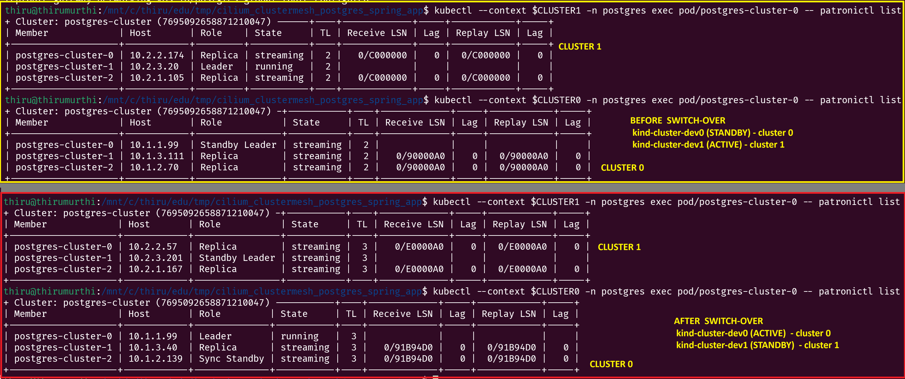

## Multi-cluster Cilium Clustermesh Demonstrating Active-Standby Database and Active-Active Application

This article shows the steps to setup two Kubernetes cluster using KinD CLI and configuring the clustermesh  with Cilium. The primary goal is to demonstrate how to configure Postgres Database in synchronized streaming replication mode between cluster. This requires the Postgres database should be discoverable between cluster, so it gets configured Active-Standby mode. To demonstrate the switch over, a simple Spring Boot application is created and deployed which exposes API to insert data and configured to always connect to the primary database instance at any point of time. Since the Spring Boot application deployed on both the cluster and configured to connect to the primary database this would be in Active-Active mode that means accessing the API from each cluster will render the same data.

The spring application uses Hikari pool which is configured to target the primary database instance (using `targetServerType=primary` in db url connection string). The Cilium clustermesh enables the service discovery accross clusters so the database can be access using the service name, when the Kuberentes service deployed on each cluster has the same name with specific annotations. These annotations are configued in the Postgres database configuration itself so during installation it will get added automatically. 

The Postgres database configuration in this article will deploy the cluster 0 as Active and the cluster 1 as Standby. The standby configuration can be identified from the configuration which should include the standby host and port to communicate with each clusters. Like in disastor recovery, we can switched over the database by prompting the Standby to Active and the Active to Standby. The switch over doesn't cause any disurption in the Spring Boot application itself for a moment during switch over we could see the database connection switch over to primary instance in the logs of the application.

Recently had to opportunity to work on similar architecture with totally different components. This article is to document some of the learnings, the setup is done using KinD cluster locally so it will be helpful for learing and development purposes.

### Prerequisites

  - Docker Desktop
  - KinD CLI
  - Kubectl CLI
  - Helm CLI
  - Cilium CLI (To check the status of status)
  - JBang CLI

### Summary

Summary of deploy the multi-cluster environment using KinD and configure them in clustermesh with Cilium. Once the clustermesh is enabled we can validate the service discover which will be used for configure Postgres Database in Active-Standby. The Postgres database instance itself is deployed using Zalando operator here. A  simple Spring Boot application in created and deployed to demostrate the Active-Active mode. The application is configured to connects to the primary instance of database. The full source code configurations and manfiests are available in this [Github repository](https://github.com/thirumurthis/projects/tree/main/cilium_clustermesh_postgres_spring_app).

This article does not deep dive into all the concepts, to follow the along basic understanding of Kubernetes concepts will be helpful.

1. KinD Cluster creation
  - a. Create clusters (cluster 0 and cluster 1) with kind configuration using KinD CLI.
2. Cilium deployment
  - a. Deoloy the Cilium in cluster 0 (the configuration can be found in Github repo).
  - b. Copy the cilium-ca secret created by Cilium from cluster 0 to cluster 1.
  - c. Deploy the Cilium to cluster 1.
  - d. Cilim metrics are enabled. Grafana, Prometheus and Hubble UI are configured to visualize traffic.
  - e. Kuberenetes Gateway API installed to create routes used to access the apps from host machine.
3. Database installation
  - a. Create namespaces for Zalando operator and Postgres database.
  - b. Deploy the Zalando operator on cluster 0.
  - c. Deploy the Zalando operator on cluster 1.
  - d. Create secret with database password on both clusters. The secret name should match the naming format requiered by the Zalando operator else the operator will creates its own with random password (in this case we need to manually copy those secrets to cluster 1).
  - e. Deploy Postgres DB instance in cluster 0. This will be primary database.
  - f. Deploy Postgres DB instance in cluster 1. This will be standby database, configuration includes standby_host and port.
  - g. Install route on both clusters to access the Postgres database from host machine.
4. Spring Boot application deployment
  - a. Create secret with Postgres database credentials for the Spring Boot application.
  - b. Deploy the Spring Boot application.
  - c. Create the route for application to access the API from the host machine.
5. Verify access at each step and finally perform switch over of Postgres database.


Steps to switch over postgres database 
  - Initially the Standby cluster needs to be promoted to Active, this is done by patching the Postgres cluster configuration to remove the standby configuration. In this case, the standalone_host and port configuration will be removed. Wait for a moment and then move to next step.
  - Next the Active cluster needs to be demoted to Standby. In this case the standby_host and port configuration needs to be updated using kubectl patch.

The deployed application doesn't require to be restarted after switch over.

Note, this configuration is NOT production ready refer the Cilium and Zalando documentation for such configurations to harden for security and granular access. For example, the clustermesh communication uses NodePort which is not recommended use LoadBalancer instead.

### Source code

The full configuration and manifests used to setup the multi-cluster environment can be found in this [Github repository](https://github.com/thirumurthis/projects/tree/main/cilium_clustermesh_postgres_spring_app).

The files in the Github repo are structured like below,
  - File name starting with cluster_0 includes configuration specific for cluster 0.
  - File name starting with cluster_1 includes configuration specific for cluster 1.
  - File name starting with culsters_ is the common configuration for both the clusters.
  - readme.md file includes documents the command when navigated to this path after cloning we can execute each in order to setup everything.
  - spring-app folder contains code for Spring Boot application and manifest to deploy.

The Github repo is configured with predefined values like cluster name, ports. If wanted to update consider below points
  - cluster names used are cluster-dev0 and cluster-dev1
  - extraPortMappings uses host port 8081, 8085, 8082, 8086, etc in KinD configuration for HTTP, HTTPS and TCP traffic. The TCP is used for Postgres database access from the host machine.
  - If considering to change cluster names or ports, the cilium manfiest also needs to be updated.

### Create Kind clusters

The KinD configuration includes extraPortMappings the ports are used to access apps from host machine, the subnet for pod and service defined since the Cilium requires different IP address. 

The default kubeProxy is disabled, the Cilium configuration needs to be updated with below details so clusters can communicate. 

```yaml
kubeProxyReplacement: true
k8sServiceHost: cluster-dev0-control-plane  # the docker container name
k8sServicePort: 6443
```

KinD configuration for cluster 0

```yaml
# file name: cluster_0_kind_config.yaml
kind: Cluster
apiVersion: kind.x-k8s.io/v1alpha4
networking:
   disableDefaultCNI: true
   podSubnet: "10.1.0.0/16"
   serviceSubnet: "10.11.0.0/16"
   kubeProxyMode: "none"
nodes:
  - role: control-plane
    extraPortMappings:
      - containerPort: 31081
        hostPort: 8081
        protocol: TCP
      - containerPort: 31443
        hostPort: 8443
        protocol: TCP
      - containerPort: 31235
        hostPort: 8085
        protocol: TCP
  - role: worker
  - role: worker
  - role: worker
```

To create the cluster use below command with above kind configuration

```sh
kind create cluster --name cluster-dev0 --config cluster_0_kind_config.yaml
```

KinD configuration for cluster 1

```yaml
# cluster_1_kind_config.yaml
kind: Cluster
apiVersion: kind.x-k8s.io/v1alpha4
networking:
   disableDefaultCNI: true
   podSubnet: "10.2.0.0/16"
   serviceSubnet: "10.12.0.0/16"
   kubeProxyMode: "none"
nodes:
  - role: control-plane
    extraPortMappings:
      - containerPort: 31082
        hostPort: 8082
        protocol: TCP
      - containerPort: 31444
        hostPort: 8444
        protocol: TCP
      - containerPort: 31236
        hostPort: 8086
        protocol: TCP
  - role: worker
  - role: worker
  - role: worker
```

To create the cluster 1 apply the manifest using below command

```sh
kind create cluster --name cluster-dev1 --config cluster_1_kind_config.yaml
```

#### Configure the kubernetes context to variable 

Kubernetes context is set to variables so the following commands in this article would make the installation easier. When cluster is created the kubernetes config is automatically updated in the kube config file.

```sh
CLUSTER0=kind-cluster-dev0
CLUSTER1=kind-cluster-dev1 
```

### Create Cilium clustermesh

The Cilium configuration that needs to be applied to both the cluster is shown below, the configuration will be passed in helm command as override file.

The clustermesh configuraiton includes the cluster name which we include the control plane docker container name. The clustermesh API server communicates using the node port that is configured. The envoy proxy requires capablities to install the containers which is added in the configuration.

```yaml
#file name: clusters_cilium_common_config.yaml
clustermesh:
  config:
    clusters:
      kind-cluster-dev0:
        enabled: true
        address: cluster-dev0-control-plane
        port: 32379 
      kind-cluster-dev1:
        enabled: true
        address: cluster-dev1-control-plane
        port: 32380

gatewayAPI:
   enabled: true
   hostNetwork:
    enabled: false # if true TCPRoute doesn't allow traffic so set to false

kubeProxyReplacement: true

l7Proxy: true

envoy:
  enabled: true
  securityContext:
    capabilities:
      keepCapNetBindService: true
      envoy:
      - NET_BIND_SERVICE
      - NET_ADMIN
      - SYS_ADMIN
      - BPF

# Mandated for Kind environments so Cilium attaches to the 
# nested container cgroup layout properly
cgroup:
  autoMount: 
    enabled: true
  hostRoot: /sys/fs/cgroup

ipam:
  mode: kubernetes

hubble:
  relay: 
    enabled: true
  metrics:
    enableOpenMetrics: true
    enabled:
     - dns:query;ignoreAAAA
     - drop
     - tcp
     - flow
     - icmp
     - http
     - https
  ui:
    enabled: true

operator:
  prometheus:
     enabled: true 
     port: 6942
```

#### Deploy the Cilium to cluster 0 

The Cilium clustermesh requires name and id for the clusters. The Cilium creates an agent (cilim pod) and api server. The NodePort will be used for clusermesh api server to communicate between clusters. In production a LoadBalancer is recommended to harden for security. The extraDNSNames configuration is used for tls communication between clusters.

```yaml
#file name: cluster_0_cilium_config.yaml
cluster:
  name: kind-cluster-dev0
  id: 1

clustermesh:
  useAPIServer: true

  config:
    enabled: true

  apiserver:
    service:
      type: NodePort  # clusterMesh Api in this case exposed using NodePort 
      nodePort: 32379 # all cilium pods from other cluster will reach to this endpoint
      annotations: {}

    tls:
      auto:
        enabled: true
        method: cronJob
        server:
          extraDnsNames:
            - cluster-dev0-control-plane
            - cluster-dev1-control-plane

# since the kubeproxy is disabled the docker control plane hostname should be added
k8sServiceHost: cluster-dev0-control-plane
k8sServicePort: 6443
```

The Cilium cluster deployed in kube-system namespace using helm chart, below command will install to cluster 0.

```sh
helm upgrade -i cilium oci://quay.io/cilium/charts/cilium --version 1.20.2 \
   --namespace kube-system \
    -f clusters_cilium_common_config.yaml \
    -f cluster_0_cilium_config.yaml \
    --kube-context $CLUSTER0
```

#### Copy the certificate secret from the cluster 0 to cluster 1

Instead of creating the certificate secret seperately and using it, we let the Cilium to create certificate and copy that. This certificate will be used for clustermesh configuration. This also required for communication between cluster 0 and cluster 1 using common certificate. This is not suitable for production, refer the documents on how to configure securely.

The certificate secret created can be copied to cluster 1 using below command.

```bash
kubectl --context $CLUSTER0 get secret -n kube-system cilium-ca -o yaml | \
    kubectl --context $CLUSTER1 create -f -
```

#### Deploy the Cilium to cluster 1

The Cilium configuration for cluster 1 is shown below

```yaml
#file name: cluster_1_cilium_config.yaml
cluster:
  name: kind-cluster-dev1
  id: 2

clustermesh:
  useAPIServer: true

  config:
    enabled: true

  apiserver:
    service:
      type: NodePort
      nodePort: 32380
      annotations: {}

    # below is required for the Apiserver cilium to start correctly
    tls:
      auto:
        enabled: true
        method: cronJob
        server:
          extraDnsNames:
            - cluster-dev0-control-plane
            - cluster-dev1-control-plane

k8sServiceHost: cluster-dev1-control-plane
k8sServicePort: 6443
```

Helm commmand to install to cluster 1 is shown below

```sh
helm upgrade -i cilium oci://quay.io/cilium/charts/cilium --version 1.20.2 \
   --namespace kube-system \
    -f clusters_cilium_common_config.yaml \
    -f cluster_1_cilium_config.yaml \
    --kube-context $CLUSTER1
```

#### Enabling monitoring for Cilium metrics

The Cilium monitioring configuration is referenced from the [Cilium example in Github repository]( `https://raw.githubusercontent.com/cilium/cilium/refs/heads/main/examples/kubernetes/addons/prometheus/monitoring-example.yaml`). The Prometheus and Grafana image are updated to latest in the manfiest configuration deployed.

To access the apps from the host machine Kubernetes Gateway API is installed. With the Cilium Gatewayclass configured we can create HTTPRoute to access UI apps using path prefix. Since we use path based routing, the monitoring configuration also needs to be updated.

For Grafana the monitoring configuration need to include below environment variables

```yaml
    env:
    - name: GF_SERVER_ROOT_URL
        value: "%(protocol)s://%(domain)s:%(http_port)s/grafana/"
    - name: GF_SERVER_SERVE_FROM_SUB_PATH
        value: "true"
```

The Prometheus routing is accessible with http://localhost:8081/prometheus and that path is configured in Grafana data source like below.

```yaml
    datasources:
    - name: prometheus
      # routing the endpoint path the /prometheus should be added
      url: http://prometheus:9090/prometheus
      #...
```

The monitoring manfiest file found in Github repo [clusters_cilium_metrics_monitoring.yaml](https://raw.githubusercontent.com/thirumurthis/projects/refs/heads/main/cilium_clustermesh_postgres_spring_app/clusters_cilium_metrics_monitoring.yaml). To apply the changes we need to use below command

```sh
kubectl --context $CLUSTER0 -n cilium-monitoring apply -f clusters_cilium_metrics_monitoring.yaml
```

```sh
kubectl --context $CLUSTER1 -n cilium-monitoring apply -f clusters_cilium_metrics_monitoring.yaml
```

#### Deploy Gateway API on each clusters

To Kuberentes API Gateway needs to be installed to create routes instead of using the ingress controller, with the Cilium GatewayClassConfig and Gateway defined in the cilium-monitoring namespace we can define routes to access the application from the host machine. Below command deploys the CRD's to each clusters.

```sh
kubectl --context $CLUSTER0 apply --server-side -f https://github.com/kubernetes-sigs/gateway-api/releases/download/v1.6.1/standard-install.yaml

kubectl --context $CLUSTER1 apply --server-side -f https://github.com/kubernetes-sigs/gateway-api/releases/download/v1.6.1/standard-install.yaml
```

After installing the Gateway API we can create GatewayClass with cilium controller and CiliumGatewayClassConfig. The Gateway definition defines listener to listen for traffic on 80 and 5432 port of the cluster. The extraPortMappings port will be updated to the NodePort service created by the below Gateway configuration. There are other options refer the [Cilium documentation Gateway parameter](https://docs.cilium.io/en/latest/network/servicemesh/gateway-api/parameterized-gatewayclass/).

Below is the manifest deployed to cilium-monitoring namespace with Grafana and Prometheus used to collect and visualize the metrics from Cilium. The GatewayClass, CiliumGatewayClassConfig and Gateway can be installed in different namespace in that case the route configuration should be updated with the correct Gateway name and the namespace.

```yaml
# clusters_gatewayClass.yaml
---
apiVersion: gateway.networking.k8s.io/v1
kind: GatewayClass
metadata:
  name: nodeport-gateway-class
spec:
  controllerName: io.cilium/gateway-controller
  description: The default Cilium GatewayClass
  parametersRef:
    group: cilium.io
    kind: CiliumGatewayClassConfig
    name: nodeport-gateway-config
    namespace: cilium-monitoring
---
apiVersion: cilium.io/v2alpha1
kind: CiliumGatewayClassConfig
metadata:
  name: nodeport-gateway-config
  namespace: cilium-monitoring
spec:
  service:
    type: NodePort
---
apiVersion: gateway.networking.k8s.io/v1
kind: Gateway
metadata:
  name: nodeport-gateway
  namespace: cilium-monitoring
spec:
  gatewayClassName: nodeport-gateway-class
  listeners:
    # LISTENER 1: For Spring Boot app, Grafana, Hubble, etc.
    - name: web-gw
      port: 80
      protocol: HTTP
      allowedRoutes:
        namespaces:
          from: All

    # LISTENER 2: For PostgreSQL TCPRoute
    - name: postgres-gw
      port: 5432
      protocol: TCP
      allowedRoutes:
        namespaces:
          from: All
---
```

To apply the above manfiest to cluster 0 and cluster 1, use below command

```sh
kubectl --context $CLUSTER0 apply -f clusters_gatewayClass.yaml
kubectl --context $CLUSTER1 apply -f clusters_gatewayClass.yaml 
```

The above gatewayclass configuration will create a NodePort service in this case the name would be cilium-gateway-nodeport-gateway. The NodePort service gets created with random port, this needs to be updated with the port defined in the KinD configuration under extraPortMappings container port. For the http traffic we used 31081 and 31235 for TCP port. After updating the port the incoming traffic from the host machine will be routed as expected.

To update the port, we can use below command to patch on cluster 0 and cluster 1. The Cilium Gateway configuration doesn't have a configuration parameter to define this directly in the configuration. Refer the Cilium GatewayClass parameter documentation. 

```sh
kubectl --context $CLUSTER0 patch svc cilium-gateway-nodeport-gateway -n cilium-monitoring -p='{"spec":{"ports":[{"port":80,"nodePort":31081},{"port":5432,"nodePort":31235}]}}'
```

```sh
kubectl --context $CLUSTER1 patch svc cilium-gateway-nodeport-gateway -n cilium-monitoring -p='{"spec":{"ports":[{"port":80,"nodePort":31082},{"port":5432,"nodePort":31236}]}}'
```

With the Gatewayclass configured, HTTPRoute can be created and installed for Grafana, Prometheus and Hubble UI aoos. The manfiest for routing is shown below.

Info
  - The Grafana and the Prometheus is configure to be accessed using the URL path. That is we use URL http://localhost:8081/grafana and http://localhost:8081/prometheus access the UI's.
  - The Hubble UI route uses domain based access, to access from hte host machine. Set the host file on with the loopback address `127.0.0.1 hubble.local` and from the browser try http://hubble.local:8081/. 

```yaml
# file name: clusters_routes_grafana_prometheus_hubble.yaml
---
apiVersion: gateway.networking.k8s.io/v1
kind: HTTPRoute
metadata:
  name: http-grafana-route
  namespace: cilium-monitoring
spec:
  parentRefs:
  - name: nodeport-gateway
    namespace: cilium-monitoring
  rules:
  - matches:
    - path:
        type: PathPrefix
        value: /grafana
    backendRefs:
    - name: grafana
      port: 3000
---
apiVersion: gateway.networking.k8s.io/v1
kind: HTTPRoute
metadata:
  name: http-prometheus-route
  namespace: cilium-monitoring
spec:
  parentRefs:
  - name: nodeport-gateway
    namespace: cilium-monitoring
  rules:
  - matches:
    - path:
        type: PathPrefix
        value: /prometheus
    backendRefs:
    - name: prometheus
      port: 9090
---
apiVersion: gateway.networking.k8s.io/v1
kind: HTTPRoute
metadata:
  name: http-hubble-route
  namespace: kube-system
spec:
  parentRefs:
  - name: nodeport-gateway
    namespace: cilium-monitoring
  hostnames:
  - "hubble.local"
  rules:
  - matches:
    - path:
        type: PathPrefix
        value: /
    backendRefs:
    - name: hubble-ui
      port: 80
```

Apply the configuration to the cluster 0 and cluster 1 using below command


```sh
kubectl --context $CLUSTER0 apply -f clusters_routes_grafana_prometheus_hubble.yaml
kubectl --context $CLUSTER1 apply -f clusters_routes_grafana_prometheus_hubble.yaml
```

With the routes configured we can access the UI's from host machine.


#### Testing service discover with the Cilium clustermesh

To test the service discovery the Monitoring and Gatwayclass configuration is not required. 

We can follow below steps to test the service discovery with configured Cilium clustermesh. 
 - Deploy the nginx pod on cluster 1.
 - From cluster 0, we will be accessing the nginx pod.
 - To access the pod we create service on both clusters with the same name. Since the nginx pod is deployed only on the cluster 0 we need to update the service on cluster 0 with an annotation `service.cilium.io/shared: 
 "false"` letting Cilium know that there is no backend service on that cluster and route traffic to the other cluster since each service is annotated with `service.cilium.io/global: "true"`.
 - With the service installed on each cluster, from cluster 0 when accessing the nginx pod on cluster 1 we should see the response if the service discovery works.

Below is the cluster 0 service used to test the service discovery as mentioned above the annotation is added.

```yaml
apiVersion: v1
kind: Service
metadata:
  name: multi-cluster-service
  annotations:
    service.cilium.io/global: "true"
    # Tells Cilium that cluster1 has no local backends
    service.cilium.io/shared: "false"
spec:
  ports:
  - port: 80
    targetPort: 80
  selector:
    app: backend
```

The service for cluster 1 which includes both the annotation.

```yaml
apiVersion: v1
kind: Service
metadata:
  name: multi-cluster-service
  annotations:
    service.cilium.io/global: "true"
    service.cilium.io/shared: "true"
spec:
  ports:
  - port: 80
    targetPort: 80
  selector:
    app: backend
```

Deploy the above service manfiest using below command

```sh
kubectl --context $CLUSTER0 apply -f cluster_0_test_global_service.yaml 
kubectl --context $CLUSTER1 apply -f cluster_1_test_global_service.yaml 
```

Create a nginx pod using kubectl command directly in the cluster 1. Then update the index.html content. Commands are shown below

```sh
kubectl --context $CLUSTER1 run backend-pod --image=nginx:alpine --labels="app=backend"
kubectl --context $CLUSTER1 exec backend-pod -- sh -c 'echo "hello from cluster1 Network" > /usr/share/nginx/html/index.html'
```

Now from cluster 0 we can use curl container to access the nginx pod on the other cluster, if service discovery works there should be a response

```sh
kubectl --context $CLUSTER0 run test-client --rm -it --image=curlimages/curl --restart=Never -- curl -s http://multi-cluster-service
```


#### Validating the Cilium clustermesh status

The status of the clustermesh is verified using Cilium CLI. In below we download the Cilium CLI to a container within the docker. The Cilium CLI can be installed to the machine and verified but to isolate the CLI from local machine using a container. Already the contaier has access to the clusters since it is also deployed in the same network. The steps are as follows.

Create the container using below command. The home directory and current working directory is mounted which can be accessed within the container.

```sh
docker run -it --rm -v ${HOME}:/root -v ${PWD}:/work -w /work --net host alpine sh
```

After container is installed it will display a prompt for further inputs, execute below commands on that prompt.

```sh 
apk add --no-cache curl 
apk add --no-cache bash

curl -LO "https://dl.k8s.io/release/$(curl -L -s https://dl.k8s.io/release/stable.txt)/bin/linux/amd64/kubectl"

chmod +x ./kubectl
install -o root -g root -m 0755 kubectl /usr/local/bin/kubectl

CILIUM_CLI_VERSION=$(curl -s https://raw.githubusercontent.com/cilium/cilium-cli/main/stable.txt)
CLI_ARCH=amd64
if [ "$(uname -m)" = "aarch64" ]; then CLI_ARCH=arm64; fi
curl -L --fail --remote-name-all https://github.com/cilium/cilium-cli/releases/download/${CILIUM_CLI_VERSION}/cilium-linux-${CLI_ARCH}.tar.gz{,.sha256sum}
sha256sum --check cilium-linux-${CLI_ARCH}.tar.gz.sha256sum
tar -xzf cilium-linux-${CLI_ARCH}.tar.gz 
mv cilium /usr/local/bin
rm cilium-linux-${CLI_ARCH}.tar.gz cilium-linux-${CLI_ARCH}.tar.gz.sha256sum
```

After the CLI is installed, we can check the status using below command with Cilium CLI.

```sh
CLUSTER0=kind-cluster-dev0
CLUSTER1=kind-cluster-dev1 

cilium status --context $CLUSTER0
cilium clustermesh status --context $CLUSTER0

cilium status --context $CLUSTER1
cilium clustermesh status --context $CLUSTER1 
```


### Deploying Postgres database using Zalando operator

Create the zalando and postgres namespace in each cluster. The operator will be deployed in the zalando namespace. Below commands will create the namespaces

```sh
kubectl --context $CLUSTER0 create ns zalando
kubectl --context $CLUSTER0 create ns postgres
kubectl --context $CLUSTER1 create ns zalando
kubectl --context $CLUSTER1 create ns postgres
```

Deploy the zalando operator in both the clusters 

Additionally the helm set includes a configuration so that when the Postgres database cluster is uninstalled the secrets created with password will not be removed by the operator. The database password is created in secret and installed on each cluster the manfiest for the secret is shown in next section.

To deploy in cluster 0

```sh
helm upgrade --install  postgres-operator \
postgres-operator-charts/postgres-operator \
-n zalando \
--set configKubernetes.enable_secrets_deletion=false \
--create-namespace \
--kube-context $CLUSTER0
```
To deploy in cluster 1 

```sh
helm upgrade --install postgres-operator \
postgres-operator-charts/postgres-operator \
-n zalando \
--set configKubernetes.enable_secrets_deletion=false \
--create-namespace  \
--kube-context $CLUSTER1
```

##### Create secrets for Postgres Database on clusters

By default when installing the Postgres Database instance the operator will create a secret with randomly generated value as password. This secret password needs to be copied to the standby cluster before installing the postgres database in the other cluster else the standby cluster will not be able to authenticate and streaming replication will fail. Copying the secret to the standby cluster is mandatory.

Note, the secret name should be in the same format as expected by the Zalando operator secret naming template. Zalando operator will create two secrets for primary and standby. The secret name format will be like `{username}.{clustername}.credentials.postgresql.acid.zalan.do` for postgres user it would be `postgres.postgres-cluster.credentials.postgresql.acid.zalan.do` and for standby user `standby.postgres-cluster.credentials.postgresql.acid.zalan.do`. Also the label should match with the postgres cluster configuration. Rerfer [zalando operator documenation](https://opensource.zalando.com/postgres-operator/docs/user.html)

```yaml
apiVersion: v1
kind: Secret
metadata:
  name: postgres.postgres-cluster.credentials.postgresql.acid.zalan.do
  namespace: postgres
  labels:
    application: spilo
    cluster-name: postgres-cluster
    team: postgres
data:
  password: cHJpbWFyeVBhc3N3b3JkMTIz
  username: cG9zdGdyZXM=
type: Opaque
---
apiVersion: v1
kind: Secret
metadata:
  name: standby.postgres-cluster.credentials.postgresql.acid.zalan.do
  namespace: postgres
  labels:
    application: spilo
    cluster-name: postgres-cluster
    team: postgres
data:
  password: c3RhbmRieVBhc3N3b3JkMTIz
  username: c3RhbmRieQ==
type: Opaque
---
```

```sh
kubectl --context $CLUSTER0 apply -f clusters_primary_standby_postgres_secret.yaml
kubectl --context $CLUSTER1 apply -f clusters_primary_standby_postgres_secret.yaml
```
#### Install the Postgres database to cluster 0

Below is the cluster 0 postgres cluster config manifest which would be the primary. To deploy use kubectl command

```yaml
# file name: cluster_0_postgres_config.yaml
apiVersion: "acid.zalan.do/v1"
kind: postgresql
metadata:
  name: postgres-cluster
  namespace: postgres
spec:
  teamId: "postgres"
  numberOfInstances: 3
  users:
    zalando:  # database owner
    - superuser
    - createdb
  databases:
    zalando: zalando  # dbname: owner
  postgresql:
    version: "18"
    parameters:
       wal_level: "replica"
       max_wal_senders: "10"
       # Force standard postgres transactions to wait for synchronous replication verification
       synchronous_commit: "on"  
  
  patroni:
    ttl: 30
    loop_wait: 10
    retry_timeout: 10
    
    # Enable synchronous replication so 'pg_rewind' won't delete data on switchover
    synchronous_mode: true
    synchronous_mode_strict: true # Set to false if needed the writes to stay unblocked if 2 out of 3 pods crash
    
    pg_hba: 
      - local replication standby               trust 
      - local all         all                   trust   
      - host  all         all     127.0.0.1/32  trust
      - host replication  standby all           md5     
      - host all          all     all           md5     
  # service annotation used for service discovery
  serviceAnnotations:
    service.cilium.io/global: "true"
    service.cilium.io/affinity: "none"      
  volume:
    size: 4Gi
```

```bash
kubectl --context $CLUSTER0 -n postgres apply -f cluster_0_postgres_config.yaml
```

Check the status of the pod deployed to the cluster 0 using 

```sh
kubectl --context $CLUSTER0 -n postgres get pods
``` 

#### Install the Postgres TCPRoute to cluster 0

```yaml
# file name: clusters_tcpRoute_postgres.yaml
---
apiVersion: gateway.networking.k8s.io/v1
kind: TCPRoute
metadata:
  name: postgres-global-route
  namespace: postgres
spec:
  parentRefs:
  - name: nodeport-gateway
    namespace: cilium-monitoring
  rules:
    - backendRefs:
        - name: postgres-cluster
          port: 5432

```
Apply the TCP route config for the postgres db on cluster 0

```bash
kubectl --context $CLUSTER0 -n postgres apply -f clusters_tcpRoute_postgres.yaml
```

#### Install Postgres Database to cluster 1

Postgres cluster configuration manfiest for cluster 1 is shown below. The standby cluster requires the standby_host and port configured with the primary database in here we configure the service name since the Cilium clustermesh service discovery is available, the standby cluster Postgres container will be able to communicate with the service name. 

The streaming replication can be achived without Cilium clustermesh, tried using the KubeVip configured for each pod. The kubeVip creates a Loadbalancer for the Kuberentes cluster, and the IP address and a NodePort was configured in the Postgres configuration standby host and port. This approach is not explained here.

```yaml
# file name: cluster_1_postgres_config.yaml
apiVersion: "acid.zalan.do/v1"
kind: postgresql
metadata:
  name: postgres-cluster
spec:
  teamId: "postgres"
  volume:
    size: 4Gi
  numberOfInstances: 3
  postgresql:
    version: "18"

  standby:
    standby_host: "postgres-cluster.postgres.svc.cluster.local"
    standby_port: "5432"
  patroni:
    pg_hba: 
      - local replication standby               trust 
      - local all         all                   trust   
      - host  all         all     127.0.0.1/32  trust
      - host replication  standby all           md5     
      - host all          all     all           md5

  serviceAnnotations:
    service.cilium.io/global: "true"
    service.cilium.io/affinity: "none"
```

Deploy the Postgres cluster config manifest to standby cluster 1

```bash
kubectl --context $CLUSTER1 -n postgres apply -f cluster_1_postgres_config.yaml
```

The same TCPRoute configuration used for cluster 0 can be apply to cluster 1.

```sh
kubectl --context $CLUSTER1 -n postgres apply -f clusters_tcpRoute_postgres.yaml
```

#### Check the status of the Postgres on clusters 

To check the status of the deployed postgres instance on each cluster use below command

```sh
kubectl --context $CLUSTER0 -n postgres exec pod/postgres-cluster-0 -- patronictl list
kubectl --context $CLUSTER1 -n postgres exec pod/postgres-cluster-0 -- patronictl list
```


To connect the Postgres DB from host machine used VSCode extension called Microsoft PostgresSQL.Use the connection string tab and the connection string would look like below. The password is skipped and should be provided in the password text box. 

Connection string general foramt `postgres://[user]:[password]@[host]:[port]/[database_name]`. If needed disable the SSL option in the configuration.

In this case to connect to the primary database instance we use the host port 8085 as configured in the KinD configuration extraPortMappings

```sh
postgres://postgres:@127.0.0.1:8085/postgres
```


### Deploying Spring Boot application

To demonstrate the Active-Active mode we create a simple JBang Spring Boot application. The application connected to the database using Hikari connection pool the database url connection string is set with the property to track the primary read-write instance. The Postgres JDBC url for the application looks like this `jdbc:postgresql://127.0.0.1:8081/postgres?targetServerType=primary&hostRecheckSeconds=10` where the `targetServerType=primary` is used to track the primary with the additional timeout properties. Refer the [Postgresql database documentation](https://jdbc.postgresql.org/documentation/use) for more details.

Note, during the application deployment sometimes the app restarts couple of times from the logs could see that the application is trying to connect to the primary database and eventually application became healthy.

#### Building the Application image

The folder structure of the application is shown below. The App.java includes the java code, application.yaml under config is only for local testing. The Jbang runtime options to specify the the path of application.yaml. In Kubernetes deployment the application.yaml is configured in configmap and mounted to the path so application.yaml is accessible by the Spring context. 

```
spring-app
      |- app
      |     |- App.java
      |- config
      |     |- application.yaml
      |- jar.Dockerfile
```

The application exposes two API's, one to create a product using POST request and another to fetch all records from DB using GET request. The HTTPRoute will be forwarding traffic to the application which will look like http://localhost:8081/my-app/

The application code App.java

```java
///usr/bin/env jbang "$0" "$@" ; exit $?

package app;
//JAVA 25+

//RUNTIME_OPTIONS -Dspring.config.location=file:./config/application.yaml

//DEPS org.springframework.boot:spring-boot-dependencies:4.0.1@pom
//DEPS org.springframework.boot:spring-boot-starter-web
//DEPS org.springframework.boot:spring-boot-starter-data-jpa
//DEPS org.postgresql:postgresql:42.7.13
//DEPS org.slf4j:slf4j-simple:2.0.13
//DEPS org.slf4j:slf4j-api:2.0.13

import jakarta.persistence.*;
import org.slf4j.Logger;
import org.slf4j.LoggerFactory;
import org.springframework.boot.SpringApplication;
import org.springframework.boot.autoconfigure.SpringBootApplication;
import org.springframework.data.jpa.repository.JpaRepository;
import org.springframework.stereotype.Repository;
import org.springframework.web.bind.annotation.*;

import java.util.List;

@SpringBootApplication
@RestController
@RequestMapping("/products")
public class App {

      // Define the SLF4J logger instance
    private static final Logger log = LoggerFactory.getLogger(App.class);

    public static void main(String[] args) {
        SpringApplication.run(App.class, args);
    }

    private final ProductRepository repository;

    public App(ProductRepository repository) {
        this.repository = repository;
    }

    @GetMapping
    public List<Product> getAll() {
         log.info("Received GET request to fetch all products.");

         List<Product> products = repository.findAll();
         log.info("Fetched {} products from the database. products {}", products.size(), products);

        return products;
    }

    @PostMapping
    public Product create(@RequestBody Product product) {
        log.info("Received POST request to create a product. Request body: {}", product);
        
        Product savedProduct = repository.save(product);
        
        // Log the resulting values returned after the database transaction
        log.info("Successfully saved product to repository: {}", savedProduct);
        return savedProduct;
    }
}

@Entity
@Table(name = "products")
class Product {
    @Id
    @GeneratedValue(strategy = GenerationType.IDENTITY)
    private Long id;
    private String name;

    public Long getId() { return id; }
    public void setId(Long id) { this.id = id; }
    public String getName() { return name; }
    public void setName(String name) { this.name = name; }

    @Override
    public String toString() {
        return "Product{id=" + id +", name='" + name + "'}";
    }
}

@Repository
interface ProductRepository extends JpaRepository<Product, Long> {
}
```

Note, the dependency are resolved ahead of the container image creation in the local machine so we can reduce the application start time. The dependency are resolved using JBang CLI.

With the code placed in the appropriate structure, navigate to the top level of app folder and execute below command. After execution a lib folder with dependency jar and App.jar will be created.

```sh
jbang export portable app/App.java 
```

The jar.Dockerfile content which will be used to create the image in local

```Dockerfile
FROM eclipse-temurin:25-jre-jammy

WORKDIR /app

COPY /lib /app/lib

COPY App.jar /app/App.jar

# Get the class name entry point using jar -tvf App.jar uses package 
ENTRYPOINT ["java", "-cp", "/app/App.jar:/app/lib/*", "app.App"]
```

To build the image in local use below command, which will create a image with name `my-api-app:1.0.1`

```sh
docker build --progress plain -t my-api-app:1.0.1 . -f jar.Dockerfile
```

To load the local docker image to the KinD clusters use below kind command. Note, we pass the kind cluster name in this case.

```bash 
kind load docker-image my-api-app:1.0.1 --name cluster-dev0
kind load docker-image my-api-app:1.0.1 --name cluster-dev1
```

#### Deploying the Spring Boot application

Create namespace using below command on each cluster

```sh
kubectl --context $CLUSTER0 create ns app
kubectl --context $CLUSTER1 create ns app
```

Create a secret with Postgres credentials and url. The db-url value is encoded, the user and password info fetched from the postgres secret itself.

Below command will create the secret in cluster 0

```sh
kubectl --context $CLUSTER0 get -n postgres secret postgres.postgres-cluster.credentials.postgresql.acid.zalan.do -o go-template='{{ printf "apiVersion: v1\nkind: Secret\nmetadata:\n  name: postgres-credentials\n  namespace: app\ntype: Opaque\ndata:\n  db-user: %s\n  db-password: %s\n  db-url:  'amRiYzpwb3N0Z3Jlc3FsOi8vMTI3LjAuMC4xOjgwODEvcG9zdGdyZXM/dGFyZ2V0U2VydmVyVHlwZT1wcmltYXJ5Jmhvc3RSZWNoZWNrU2Vjb25kcz0xMA=='\n" (index .data "username") (index .data "password") }}' | kubectl --context $CLUSTER0 apply -f -
```

Below command will create the secret in cluster 1

```bash
kubectl --context $CLUSTER1 get -n postgres secret postgres.postgres-cluster.credentials.postgresql.acid.zalan.do -o go-template='{{ printf "apiVersion: v1\nkind: Secret\nmetadata:\n  name: postgres-credentials\n  namespace: app\ntype: Opaque\ndata:\n  db-user: %s\n  db-password: %s\n  db-url: 'amRiYzpwb3N0Z3Jlc3FsOi8vMTI3LjAuMC4xOjgwODEvcG9zdGdyZXM/dGFyZ2V0U2VydmVyVHlwZT1wcmltYXJ5Jmhvc3RSZWNoZWNrU2Vjb25kcz0xMA=='\n" (index .data "username") (index .data "password") }}' | kubectl --context $CLUSTER1 apply -f -
```

The spring application deployment, if needed update the version of image. Note, the configMap includes default for DB_URL and DB_USER_NAME, ideally that will be configured from the secret we created above.

```yaml
#file name: deployment.yaml
---
apiVersion: v1
kind: ConfigMap
metadata:
  name: app-config
data:
  application.yaml: |
    spring:
      datasource:
        url: ${DB_URL:jdbc:postgresql://postgres-cluster.postgres.svc.cluster.local:5432/postgres?targetServerType=primary&hostRecheckSeconds=2}
        username: ${DB_USERNAME:postgres}
        password: ${DB_PASSWORD}
        driver-class-name: org.postgresql.Driver
        hikari:
          maximum-pool-size: 10
          connection-timeout: 10000
          idle-timeout: 300000
          max-lifetime: 600000
          keepalive-time: 30000
      jpa:
        hibernate:
          ddl-auto: update
    server:
      port: 8080
---
apiVersion: apps/v1
kind: Deployment
metadata:
  name: springboot-jbang-app
spec:
  replicas: 1
  selector:
    matchLabels:
      app: springboot-jbang-app
  template:
    metadata:
      labels:
        app: springboot-jbang-app
    spec:
      containers:
      - name: app
        image: my-api-app:1.0.1
        imagePullPolicy: IfNotPresent
        ports:
        - containerPort: 8080
        resources:
          requests:
            memory: "256Mi"
            cpu: "250m"
          limits:
            memory: "768Mi"
            cpu: "650m"
        env:
        - name: SPRING_CONFIG_LOCATION
          value: "file:/etc/config/"
        - name: DB_URL
          valueFrom:
            secretKeyRef:
              name: postgres-credentials
              key: db-url
        - name: DB_USERNAME
          valueFrom:
            secretKeyRef:
              name: postgres-credentials
              key: db-user
        - name: DB_PASSWORD
          valueFrom:
            secretKeyRef:
              name: postgres-credentials
              key: db-password
        volumeMounts:
        - name: config-volume
          mountPath:  /etc/config
          readOnly: true
      volumes:
      - name: config-volume
        configMap:
          name: app-config
          items:
          - key: application.yaml
            path: application.yaml
---
apiVersion: v1
kind: Service
metadata:
  name: springboot-jbang-service
spec:
  type: ClusterIP
  ports:
    - name: http
      protocol: TCP
      port: 8080
      targetPort: 8080
  selector:
    app: springboot-jbang-app
---
```

To deploy the above manifest use below command. Namespace need to provided during deployment.

```sh
kubectl --context $CLUSTER0 -n app apply -f deployment.yaml
kubectl --context $CLUSTER1 -n app apply -f deployment.yaml
```

Install the HTTPRoute for the application, the manfiest is shown below

```yaml
# file name: app_route.yaml
---
apiVersion: gateway.networking.k8s.io/v1
kind: HTTPRoute
metadata:
  name: springboot-app-route
spec:
  parentRefs:
    - name: nodeport-gateway
      namespace: cilium-monitoring
      port: 80
  rules:
    - matches:
      - path:
            type: PathPrefix
            value: /my-app
      filters:
         - type: URLRewrite
           urlRewrite:
             path:
               type: ReplacePrefixMatch
               replacePrefixMatch: /  # Replaces "/my-app" with "/"
      backendRefs:
        - name: springboot-jbang-service
          port: 8080
```

Deploy above HTTPRoute manfiest using below command

```sh
kubectl --context $CLUSTER0 -n app apply -f app_route.yaml
kubectl --context $CLUSTER1 -n app apply -f app_route.yaml
```

Check the application pod status on each node with kubectl command.

#### Testing the deployed application

With the sample application deployed,the API can be accessed from host machine using curl command. To access the cluster 0 API endpoint the 8081 port is used as configured in kind cluster configuration.

POST request to create sample product from cluster 0

```sh  
curl -X POST http://localhost:8081/my-app/products -H "Content-Type: application/json"      -d '{"name": "test-01"}'
```

GET request to get all products from cluster 0

```sh
curl http://localhost:8081/my-app/products
```

GET request to get all prodcuts from the cluster 1 (uses 8082 port)

```bash
curl http://localhost:8082/my-app/products
```

Info
 The application is configured to utlize the primary data at any point of time which is Active-Active mode on both the cluster. In disaster recovery scenario if one of the cluster needs to be in standby then we don't expose the traffic to the external world in that case don't install the HTTPRoute for the application.

### Switch over steps

Below are the steps to perform switch over

When the configuration is deployed as-is the cluster 0 (Active) and cluster 1 (Standby) from the database point of view. To switch the cluster 0 (Standby) and cluster 1 (Active) we need to follow below steps.

1. Promte Stanby to Active
   - Remove the standby configuration from the current Standby cluster, in this case cluster 1. We can patch this using kubectl command. If needed we can create an application with appropriate RBAC rule to automatically trigger the switch-over. The command to patch is shown below

    ```sh
    kubectl --context $CLUSTER0 patch postgresql postgres-cluster -n postgres --type=merge -p '{"spec":{"standby": null}}'
    ```

2. The postgres-cluster pods in the postgres namespace will restart automatically, wait for few seconds.
3. Demote Active to Standby:
   - Update the stanby configuration (standby_host and port) to the current Active in this case cluster 0, so it will be new Standby cluster. This configuration will be applied as kubectl patch command as shown below.

    ```sh
    kubectl --context $CLUSTER1 patch postgresql postgres-cluster -n postgres --type='merge' -p '{"spec":{"standby":{"standby_host":"postgres-cluster.postgres.svc.cluster.local","standby_port":"5432"}}}'
    ```

4. Wait for few seconds for the switch over to complete. Check the logs of the postgres cluster pods on each side if there are any issues.

Check the status of the clusters using below command. After switch over we should see that the Active and Standby are switched over.

```sh
kubectl --context $CLUSTER0 -n postgres exec pod/postgres-cluster-0 -- patronictl list
kubectl --context $CLUSTER1 -n postgres exec pod/postgres-cluster-0 -- patronictl list
```

In the application logs we could see the logs indicating the switch over like below. 

```
 WARN 1 --- [l-1:housekeeper] com.zaxxer.hikari.pool.PoolBase    : HikariPool-1 - Failed to validate connection org.postgresql.jdbc.PgConnection@e946c4b (This connection has been closed.). Possibly consider using a shorter maxLifetime value.

```

Points to note
 - During switch over it is possible that both clusters be in Active-Active mode for a moment, eventually postgres cluster will become healthy after switch over is complete. 
 - Postgres utilizes DCS (Distrubted Configuration Storage) in leader election, switch over, etc. 
 - Sometimes switch over might lead to split brain issue where both cluster will be Active-Active with their own leaders. Refer the documentation for instruction, below worked for me in this setup. But be catious before following this step in production like environment.
    - To resolve this issue exec into the standby master, use the labels on the pods to identify the master (pod label should say `spilo-role=master`).
    - View the configuratuion of standby master using `patronictl show-config`, if the standby configuration is missing edit the config using `patronictl edit-config` and include the standby configuration shown below to the top and save it.
    ```yaml
    standby_cluster:
        host: "postgres-cluster.postgres.svc.cluster.local" # service discovery url
        port: 5432
        create_replica_methods:
            - basebackup
    ```
    - Then trigger pg_rewind or re-int the postgres-cluster. In the command brlow pg-cluster is the cluster name in configuration.
    ```sh
    kubectl exec -it <postgres-cluster-standby-master> -n postgres --context=<STANDY_CLUSTER_CONTEXT> -- patronictl reinit postgres-cluster <postgres-cluster-standby-master> --force
    ```
    - pg_rewind will clean up the local directory and try to sync from the pg_basebackup.
    - After the master is reinit, other pods in the Standby also needs to be re-initalized.

Postgres partonictl status before and after switch over process



Snapshot of API access from curl after switch over


Hubble UI showing the traffic flow after accessing application API endpoint using cURL command


Hubble UI showing traffic on the Postgres Database


